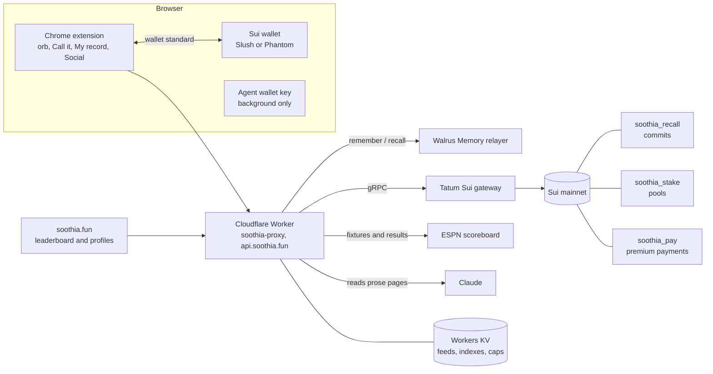

# Soothia

[](https://github.com/shrooms08/soothia/actions/workflows/ci.yml)

**Call any match before kickoff. Proven on Sui, remembered on Walrus. Get better, get followed, get paid.**

Soothia is a Chrome extension that puts a small orb on every page. On a match page it offers a call: who wins, and how sure you are. Each call is saved to Walrus Memory and its hash is committed on Sui mainnet before kickoff. After the match, ESPN's result scores it, and Soothia learns from your record.

Live: [soothia.fun](https://soothia.fun) · [Leaderboard](https://soothia.fun/leaderboard) · [@minos](https://soothia.fun/u/minos) · Track: Markets & Sports Prediction

## What it does

- **Call it.** On an ESPN match page (Premier League, Championship, LaLiga, Serie A, Bundesliga, Ligue 1) the orb offers the match. Pick a side and a confidence from 51% to 99%.
- **Proof before kickoff.** The call's SHA-256 hash is committed on Sui by the `soothia_recall` package. Anyone can check that the commit came before ESPN's kickoff time.
- **A record that learns.** Outcomes, lessons and preferences are written to Walrus Memory. They change what the tiles say, how they are ordered, and the slider's suggestion.
- **Back it.** Stake SUI on your call in a parimutuel pool (`soothia_stake`) that closes at kickoff and pays winners after a 6-hour challenge window.
- **Social.** Go public with a Sui wallet, get a Call Score, follow people, see their calls in a feed, tail them, and climb the [leaderboard](https://soothia.fun/leaderboard).
- **Premium calls, paid by x402.** A caller with a proven record can sell a call. It stays hidden until kickoff, and buyers unlock it with a signed Sui payment (`soothia_pay`), by hand or through an agent wallet with a daily budget.

## How it uses Walrus Memory

Walrus Memory is Soothia's source of truth for everything a user does. The Worker writes through the mainnet relayer (`https://relayer.memory.walrus.xyz`) with `@mysten-incubation/memwal`. Each memory is a plain sentence, so semantic search works on it, followed by a tagged JSON record that Soothia reads back exactly.

Every user and kind has its own namespace, `soothia-<userKey>-<kind>`, inside one Soothia memory account. The store is append-only: an update is a new memory, and the newest one wins.

| Kind          | What it holds                            | Example (real, from @minos's record)                                                                                                                                              |
| ------------- | ---------------------------------------- | --------------------------------------------------------------------------------------------------------------------------------------------------------------------------------- |
| `pick`        | A call                                   | Call: YES at 70% on "Will Man City beat Fulham on November 21, 2026?" (sports). About Man City, Fulham. Read on espn.com.                                                         |
| `outcome`     | How a call resolved, from ESPN           | Called it right: "Will Atlético Madrid beat Barcelona in Spanish LALIGA on Sun 8 Nov?" resolved NO. Atlético Madrid 1-2 Barcelona (ESPN, full time). My YES was 35%, Brier 0.122. |
| `lesson`      | A pattern in the record                  | Lesson about my calls: Your confidence matches your hit rate (72% claimed, 80% landed). Keep calling it like this.                                                                |
| `pref`        | Where the orb should stay quiet          | Preference: stay quiet on espn.com.                                                                                                                                               |
| `wallet_link` | The user's Sui wallet (a kind of `pref`) | My Sui wallet is 0x8e0e…bb6a.                                                                                                                                                     |
| `stake`       | SUI staked on a call                     | Staked 0.1 SUI on Arsenal win vs Newcastle on 2026-11-21.                                                                                                                         |
| `profile`     | Going public, or private again           | My public Soothia profile is @minos, for 0x8e0e…bb6a.                                                                                                                             |
| `follow`      | Who the user follows                     | I follow @juju on Soothia.                                                                                                                                                        |
| `unlock`      | A premium call the user bought           | Unlocked @minos's premium call on Nottingham Forest v AFC Bournemouth for 0.01 SUI.                                                                                               |

### How memories change the product

- **Tile notes.** Before showing a claim, the Worker reads the user's whole record and runs a semantic search for earlier calls on the same question. The tile then says things like "Your record on Chelsea: 0 of 1 right.", "On 8 Nov you called NO 65% on …: right." or "You run 14 points underconfident overall." Entity lessons come first, at most three lines.
- **Nudges.** If the calibration lesson says you run overconfident, the Call it sheet says so and suggests a value closer to 50% ("You run 9 points overconfident. Soothia suggests 64%.", with a Use button).
- **Ordering.** Tiles are sorted by relevance. A match you have already called, teams you call often and a close past call all move a tile up.
- **Lesson cards.** My record shows the newest lesson for each key, the most specific first: teams, categories, tailing, stakes and premium, consensus, favourites, market, then calibration. A new lesson is written only when its meaning changes or a figure moves by 5 points or more.
- **Quiet sites.** "Quiet here" writes a `pref`, and the orb stays quiet on that site on every device that shares the record.
- **Social.** Follows, stakes and unlocks feed lessons too, in lines like "Tailing @ada: 4 of 5 right", "Your staked calls land 75%, free ones 33%.", "Premium calls you bought hit X%, your own calls Y%."

The full learning loop, with @minos's real lessons, is in [docs/total-recall.md](docs/total-recall.md).

## How it uses Tatum

Every Sui read and write goes through Tatum's Sui gRPC gateway. The gateway labels its replies `application/grpc`, which the stock web transport rejects, so Soothia has a small fetch-only transport ([worker/src/recall/tatumGrpc.ts](worker/src/recall/tatumGrpc.ts)) that also runs inside a Cloudflare Worker. Tatum's Sui JSON-RPC URL returns 404, so gRPC is the only path.

| Feature                                                    | Tatum gRPC call                                                                                       |
| ---------------------------------------------------------- | ----------------------------------------------------------------------------------------------------- |
| Checkpoint anchors on each call                            | `LedgerService.GetCheckpoint`                                                                         |
| Committing a call's hash                                   | `signAndExecuteTransaction`, then `waitForTransaction`                                                |
| Proofs ("committed 3h before kickoff")                     | `getTransaction` with events (reads `PickCommitted` and its timestamp)                                |
| Memory account panel in My record                          | `getObject` and `GetCheckpoint`                                                                       |
| Pools: find, read, create, resolve, void, collect the fee  | `getDynamicField`, `getObject`, `signAndExecuteTransaction`                                           |
| Stakes: build for the user's wallet, confirm what happened | `Transaction.build` (object refs, gas price and gas coins), then `getTransaction` for `Staked` events |
| Claims                                                     | `Transaction.build`, then the user's wallet sends it                                                  |
| x402 settlement of premium calls                           | `executeTransaction` of the buyer's signed bytes, then the `Paid` event                               |
| Agent wallet withdrawals                                   | `listCoins`, `Transaction.build`, `executeTransaction`                                                |
| Balances (gas floors, staking and agent wallets)           | `getBalance`                                                                                          |
| SuiNS names for profiles                                   | `defaultNameServiceName`                                                                              |

**Finding:** Tatum's Data API has no Sui support as of 8 Nov 2026. `GET /v4/data/balances` and `/v4/data/transaction/history` reject `chain=sui` and `sui-mainnet`, so balances go through gRPC and there is no transaction history view.

## Architecture



- The **extension** never holds a Worker key. Wallets sign stakes, claims and payments; the background checks every transaction's exact shape before a wallet sees it ([extension/src/tx-check.ts](extension/src/tx-check.ts)).
- The **Worker** holds the keys, writes memories, commits hashes, builds unsigned transactions, settles x402 payments and runs three cron sweeps: settle calls, advance pools, rebuild public profiles.
- **ESPN** gives fixtures, kickoff times and results. A pool's close time and "proven before kickoff" always use ESPN's kickoff, never the page's.

## Contracts on Sui mainnet

| Package          | Id                                                                                                                | What it does                                                                                                                                                                                            |
| ---------------- | ----------------------------------------------------------------------------------------------------------------- | ------------------------------------------------------------------------------------------------------------------------------------------------------------------------------------------------------- |
| `soothia_recall` | [`0xc7bb…84c4`](https://suivision.xyz/package/0xc7bb1087170732a31d392f20974ba5f3dac8c4081b39f7a8677ff7d28ada84c4) | Emits `PickCommitted` with a call's hash                                                                                                                                                                |
| `soothia_stake`  | [`0xf950…720f`](https://suivision.xyz/package/0xf9507a1cb35b01c191614a67bf5ca3f22c7c3a7745fdc7ddea67369686a6720f) | Parimutuel YES/NO pools in SUI. Config [`0x7ba4…b3be`](https://suivision.xyz/object/0x7ba41f413b54f1f04b592694ad3304caa87df7cf9f1afda98b42c45362d2b3be)                                                 |
| `soothia_pay`    | [`0x6909…2a92`](https://suivision.xyz/package/0x69093f4bd2ec5d00c5780d8fd2e09adde6a4399146fed2bafc94071311d52a92) | Premium payments: 90% to the caller, 10% to the treasury, one use per nonce. PayConfig [`0x7b14…7f1e`](https://suivision.xyz/object/0x7b14fd24baed71d4062f88c22d06c61f4785fc040c3e692ae335b1cde7807f1e) |

| Capability                                                              | Held by                                                                                |
| ----------------------------------------------------------------------- | -------------------------------------------------------------------------------------- |
| `soothia_stake` AdminCap, all three UpgradeCaps, `soothia_pay` AdminCap | The operator's Slush wallet, not the Worker                                            |
| `soothia_stake` ResolverCap                                             | `RESOLVER_KEY` on the Worker: creates, resolves and voids pools, and can't move stakes |
| Gas wallet (`MEMWAL_KEY`)                                               | The Worker: pays for commits, no staking power                                         |

Ids for every cap, read from chain, are in [docs/numbers.md](docs/numbers.md). Move tests: 2 (`soothia_recall`), 44 (`soothia_stake`), 16 (`soothia_pay`).

## Live numbers

From [docs/numbers.md](docs/numbers.md), read on 10 Nov 2026 from Walrus Memory, Sui through Tatum, and KV.

|                                    |                                                                             |
| ---------------------------------- | --------------------------------------------------------------------------- |
| @minos's calls                     | 17, of which 16 were committed on Sui before kickoff                        |
| Settled                            | 15: 12 right (80%), Brier 0.191                                             |
| Public profile                     | Call Score 583, 14 settled and proven before ESPN's kickoff, 12 right (86%) |
| Walrus memories in @minos's record | 63 (31 pick, 15 outcome, 10 lesson, 3 pref, 2 profile, 1 stake, 1 follow)   |
| Lessons written                    | 10, 2 current                                                               |
| Pools created                      | 3, 0.3 SUI staked over 3 positions                                          |
| Premium calls and x402 unlocks     | 0 at the time of reading                                                    |

## Try it

1. Download [soothia.fun/soothia-extension.zip](https://soothia.fun/soothia-extension.zip) and unzip it. Or build it from this repo: `cd extension && npm install && npm run build`, which writes `extension/dist`.
2. Open `chrome://extensions`, turn on **Developer mode**, press **Load unpacked**, and choose the unzipped `soothia` folder (or `extension/dist`).
3. Open an upcoming match on ESPN, for example [Villarreal at Barcelona](https://www.espn.com/soccer/match/_/gameId/401882804), and click the orb.
4. See the public side: the [leaderboard](https://soothia.fun/leaderboard) and [@minos](https://soothia.fun/u/minos).

Calls need no wallet and no money. Staking, going public and premium calls need a Sui wallet such as Slush.

## Run it yourself

Needs Node 20+, a Cloudflare account, the Sui CLI, a Walrus Memory account, and a Tatum API key.

```sh
npm ci && (cd extension && npm ci) && (cd worker && npm ci) && (cd scripts && npm ci)
npm test && npm run typecheck
```

Worker settings go in `worker/.dev.vars` locally and in Wrangler secrets in production. Names only:

- Secrets: `ANTHROPIC_API_KEY`, `MEMWAL_KEY`, `TATUM_API_KEY`, `RESOLVER_KEY`, `ADMIN_TOKEN`, optional `SUI_COMMIT_KEY`
- Not secret: `MEMWAL_ACCOUNT_ID`, optional `MEMWAL_SERVER_URL`, `SOOTHIA_RECALL_PACKAGE`, `STAKE_PACKAGE`, `STAKE_CONFIG`, `STAKE_RESOLVER_CAP`, `STAKE_ADMIN_CAP`, `PAY_PACKAGE`, `PAY_CONFIG`, `RECALL_OWNER_KEYS`
- CLI only: `RECALL_INSTALL_ID`, and the cap ids the scripts read

```sh
cd worker && npm run dev                     # local Worker
cd worker && npx wrangler secret put TATUM_API_KEY   # once per secret
cd worker && npm run deploy                  # api.soothia.fun
cd site && npx wrangler deploy               # soothia.fun
cd move/soothia_stake && sui move test       # each Move package
npm run package-extension --prefix scripts   # site/soothia-extension.zip
cd worker && npx tsx scripts/numbers.ts      # refresh docs/numbers.md
```

Operator CLIs are in `worker/scripts/recall` (lock, list, resolve, commit-existing, verify), `worker/scripts/stake` and `worker/scripts/pay`.

## Trust and limits

- **Unaudited beta.** Stake only what you can lose. Staking may be restricted where you live.
- **Who can do what:** [docs/staking-trust.md](docs/staking-trust.md) lists every key, what it can and can't do, the challenge window and how to overturn a wrong result.
- **Caps.** Stakes: 0.1 SUI minimum, 5 SUI per person per pool, 50 SUI per pool, 1% fee (5% maximum). Premium calls: 0.01 to 0.5 SUI, and only for a public caller with a Call Score of 550 and 10 settled calls. Agent wallet: 0.1 SUI per call at most, plus a daily budget. Commits: 5 a day per user and 50 overall, with a balance floor.
- **ESPN is the resolver's source.** The contract doesn't check results. It trusts the resolver, which reads ESPN, and the 6-hour challenge window lets the AdminCap holder refund a pool.
- **One memory account.** Every user's memories live in one Soothia Walrus Memory account, kept apart by namespace. Soothia's Worker can read all of them.
- **What a premium call doesn't hide:** pool totals, a public stake, and a hash with a small search space. See [docs/x402.md](docs/x402.md).

## What's next

- Stake on any event, not just football, with an on-chain oracle instead of a resolver key.
- A Walrus Memory account per user, so each person owns their record outright.
- A mobile app.

## Docs

- [docs/total-recall.md](docs/total-recall.md): the learning loop, step by step
- [docs/numbers.md](docs/numbers.md): live numbers and every id
- [docs/staking-trust.md](docs/staking-trust.md): keys, limits and the challenge window
- [docs/x402.md](docs/x402.md): premium calls and the x402 decision
- [CHANGELOG.md](CHANGELOG.md)

## License

MIT. See [LICENSE](LICENSE). Music license in [LICENSE-music.txt](LICENSE-music.txt).
