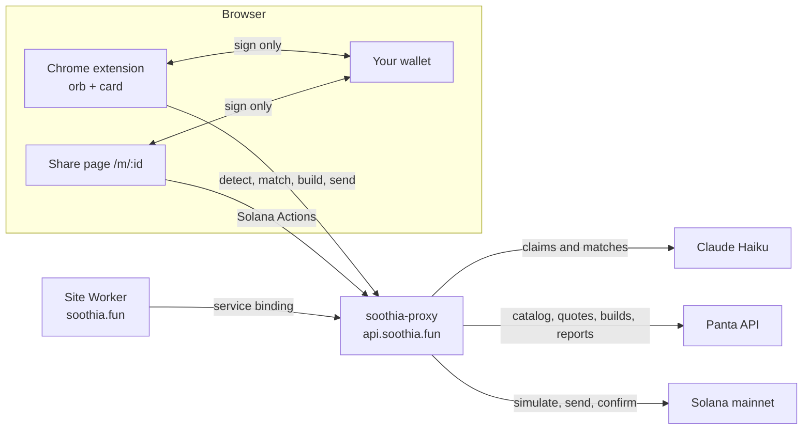

# Soothia

[](https://github.com/shrooms08/soothia/actions/workflows/ci.yml)

**Turn any take into a market.**

Soothia is a Chrome extension with a small floating orb on every page. It reads the article, tweet or match preview you are on, finds the claims in it, and shows the matching [Panta](https://docs.panta.market) prediction market with live odds. Bet YES or NO from your own wallet, or make the claim a new market in two taps. Panta markets settle in USDC on Solana mainnet.


## Try it

1. Open https://soothia.fun and download the extension zip, or build it (below).
2. In Chrome, open `chrome://extensions`, turn on **Developer mode**, click **Load unpacked**, pick the unzipped folder.
3. Open any news article, tweet or sports fixture. The orb appears bottom right; click it to see the claims.

Dry run is **on by default**: Soothia signs with your wallet but never sends, so you can walk the whole flow without spending anything. Turn it off in the card's settings when you mean it. Bets are 1 to 100 USDC.

## How it works

1. **Read.** The orb reads what you are reading and drafts up to three market-ready claims (Claude Haiku), each checked against Panta's rules. Sports fixture pages become match-winner claims with no model call.
2. **Make it a market.** A claim nobody has made yet opens the review sheet: question, resolution rule, sources, buying window. Panta builds the create transaction; your wallet signs; Soothia checks the signed bytes match and relays it.
3. **Bet.** A claim that matches an open market shows live odds. Pick YES or NO and an amount, see the fee on top, sign. Every market gets a share page with a bet link that works without the extension.

## Architecture



The API Worker holds every secret. The extension and the site hold none. Details in [docs/architecture.md](docs/architecture.md).

## Panta API integration

| Flow            | Panta endpoints                                                                         | Soothia route                                                                                  |
| --------------- | --------------------------------------------------------------------------------------- | ---------------------------------------------------------------------------------------------- |
| Create a market | `POST /markets/create/quote/`, `POST /markets/create/build/`, `POST /markets/register/` | `/create/quote`, `/create/build`, `/create/simulate`, `/create/send`, `/create/register-retry` |
| Buy YES or NO   | `POST /primaryorderbuild/`, `POST /primaryordersubmit/`, `POST /primaryorderverify/`    | `/buy/quote`, `/buy/build`, `/buy/send`, `/buy/status`; public `/api/actions/market/:id`       |
| Report a trade  | `POST /trades/`                                                                         | after confirmation, and by the 5-minute reconcile sweep                                        |
| Positions       | `GET /positions/?wallet=`                                                               | `/positions`                                                                                   |
| Claim winnings  | `POST /claim/build/`                                                                    | `/claim/build`, `/claim/send`                                                                  |
| Creator fees    | `POST /claim/creator-fees/build/`                                                       | `/claim/creator-fees/build`                                                                    |
| Catalog         | `GET /markets/`, `GET /markets/{id}/`, `GET /categories/`                               | `/markets`, `/market`, `/panta/markets`, `/panta/categories`, `/match`                         |

Every Panta path ends with a slash; the key travels in `X-Api-Key`. Market rules are in [docs/panta-create-rules.md](docs/panta-create-rules.md).

## Security model

- Non-custodial: wallets sign, Soothia relays. `signAndSendTransaction` is never used.
- The signed transaction must match the built one; only compute-budget instructions may differ.
- The relay accepts only transactions that invoke the Panta program.
- Dry run by default; 1 to 100 USDC bets; 1,150-byte cap on create transactions.
- Per-IP rate limits, an admin header on diagnostics, escaped server rendering and a Content Security Policy on the site.

Full write-up and known limitations: [docs/security.md](docs/security.md).

## Local development

Prerequisites: Node LTS, npm, a Cloudflare account for `wrangler`.

```bash
npm install && npm install --prefix extension && npm install --prefix worker && npm install --prefix scripts

npm run typecheck      # extension, worker (incl. tests), scripts
npm run lint           # eslint across the repo
npm run format:check   # prettier
npm test               # worker, extension and site unit tests (no network, no money)
npm run build          # builds the extension into a temp dir
```

Worker secrets: copy `worker/.dev.vars.example` to `worker/.dev.vars` and fill in `PANTA_API_KEY`, `ANTHROPIC_API_KEY`, `HELIUS_RPC_URL` and `ADMIN_TOKEN`. In production each is set once with `npx wrangler secret put <NAME>`. Then `cd worker && npm run dev` serves the API on http://localhost:8787 and `npm run deploy` ships it. The site deploys with `cd site && npx wrangler deploy`.

Extension: `cd extension && npm run build` writes `extension/dist` for Load unpacked. `cd scripts && npm run package-extension` rebuilds `site/soothia-extension.zip` and checks its version.

## Repo layout

```
extension/   Chrome MV3 extension (TypeScript, Vite). src/, test/, public/ (manifest, icons, fonts, music)
worker/      soothia-proxy API Worker (TypeScript, Wrangler). src/, test/, public/img
site/        Landing site Worker: index.html, worker.js (share and markets pages), src/ (wallet bundles)
scripts/     Catalog check, extension packaging, site assets, build check, site Worker tests
docs/        architecture, security, Panta create rules, bet links, wallets, catalog report
design/      Applied design screenshots and headless check harnesses (design/tools)
```

## Live proof

- Markets made and found with Soothia: https://soothia.fun/markets
- Public stats (markets created, bets placed, volume, wallets): https://api.soothia.fun/stats

## License

MIT, see [LICENSE](LICENSE). The onboarding music is not MIT licensed, see LICENSE-music.txt.
