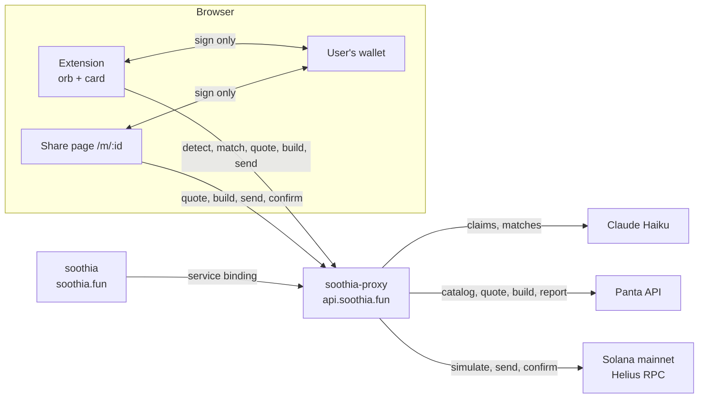

# Architecture

Soothia is three deployables and no database of its own.

| Component                  | Where                              | What it does                                                                                                                                                       |
| -------------------------- | ---------------------------------- | ------------------------------------------------------------------------------------------------------------------------------------------------------------------ |
| Chrome extension (MV3)     | `extension/`                       | Reads the page, shows the orb and card inside a closed shadow root, asks the wallet to sign. Never holds keys or funds.                                            |
| API Worker `soothia-proxy` | `worker/`, https://api.soothia.fun | Holds the Panta, Claude and RPC secrets. Drafts claims, matches markets, builds and relays Panta transactions, serves the catalog, stats and Solana Actions.       |
| Site Worker `soothia`      | `site/`, https://soothia.fun       | Static landing page plus server-rendered `/markets` and `/m/<marketId>` share pages, and `actions.json` for bet links. Talks to the API through a service binding. |

External services: Panta API (markets, quotes, transaction building, trade reporting), Claude (Haiku, via the Messages API with forced tool use), Helius (Solana mainnet RPC), and the user's own wallet.

## Request flows

### Detect (page to claims)

1. The content script waits for the page to settle, reads the article or tweet (`reader.ts`, `x-reader.ts`), or recognises a sports fixture (`fixture.ts`). Search engines, PDFs and consent walls are skipped.
2. The background worker posts `{ url, site, title, text, fixture? }` to `POST /detect` with an `X-Soothia-Install` id. Text is cut to 4,000 characters first.
3. The Worker checks the per-IP and per-install caps, then the 30-minute result cache keyed by a hash of the URL.
4. Prose: Claude is asked, through a single forced tool, for up to three claims. Each draft is validated against the Panta rules (`pantaRules.ts`): category, horizon, source quote present on the page, resolution rule and sources, question length. Rejected drafts are reported as `dropped` with a reason.
5. Fixture: two match-winner claims are written deterministically ("Will A beat B in C on D?"), with the league site or ESPN as the authority. No model call. The fixture's own evidence lines stand in for the source quote, since a fixture page has no prose to quote.
6. `POST /match` pairs each claim with open Panta markets about the same event: a word-overlap prefilter over the catalog, then one Claude call that may answer null. Matched claims show live odds; unmatched ones offer "Make it a market".

### Create (claim to live market)

1. `POST /create/quote`: the Worker fits the question, resolution rule and sources into the transaction budget (`resolution.ts`), always keeping one authoritative source, and asks Panta for a quote. The quote (price, 20 or 50 USDC) is stored under `quote:<id>` in KV for 24 hours.
2. `POST /create/build`: Panta builds the transaction; the Worker refuses anything over 1,150 bytes (Solana's limit is 1,232) and shrinks the text when needed.
3. The extension asks the wallet to sign. `tx-check.ts` compares the signed bytes with the built ones: only added or changed compute-budget instructions are allowed.
4. `POST /create/simulate` runs the transaction against the RPC; failures are explained in plain words.
5. `POST /create/send` relays the signed transaction (it must name the Panta program), waits for confirmation, then `POST /markets/register/` tells Panta about it. A failed register can be retried (`/create/register-retry`).
6. The creator's wallet is remembered under `creator:<wallet>` so My bets can show creator earnings.

Dry run is on by default: steps 1 to 4 run, nothing is sent.

### Bet (extension)

`POST /buy/quote` (Panta primary order quote, fee shown on top), `POST /buy/build` (Panta builds; byte cap applies), wallet signs, `tx-check` verifies, `POST /buy/send` relays and confirms, then the Worker reports the trade to Panta (`/primaryorderverify/`, `/trades/`). Orders are stored under `buy:<orderId>` so a client that disappears can be finished by the reconcile sweep.

### Bet (share page and bet links)

The share page and any Blink client use the public Solana Actions routes: `GET /api/actions/market/:id` (metadata and buttons), `POST ...?side&amount` (an unsigned transaction for the given account), `POST .../confirm` (chaining callback after the wallet sent it), `GET .../quote` (a price line for the page), `POST /api/tx/send` and `GET /api/tx/status` for pages that send through Soothia. A confirm that arrives without an order record is verified from the chain: the transaction must have the wallet as fee payer and name both the Panta program and the market.

## Data storage

Soothia keeps no user accounts and no page text.

| Store                                                           | Holds                                                                                                                                             | Why                                                                                                                                                                                                                                        |
| --------------------------------------------------------------- | ------------------------------------------------------------------------------------------------------------------------------------------------- | ------------------------------------------------------------------------------------------------------------------------------------------------------------------------------------------------------------------------------------------ |
| Cache API (`caches.default`) plus in-isolate memory, `store.ts` | Detect results (30 min), catalog and detail (60 s, 10 min), display quotes (15 s), stats (60 s), per-IP and per-install counters, KV budget tally | Ephemeral and cheap. The free KV tier allows 1,000 writes a day for the whole account, so everything that may be lost without harm stays out of KV.                                                                                        |
| KV `SOOTHIA_CACHE`                                              | `creator:<wallet>`, `buy:<orderId>`, `quote:<createId>`, `sig:<signature>`                                                                        | Durable records that money depends on: what a wallet created, which bets still need reporting, which create quote a transaction belongs to. Every write goes through `kvPut`, which never throws and counts itself against a daily budget. |
| Browser `chrome.storage.local`                                  | Install id, dry run, mute, sound style, remembered wallet, show-debug toggle                                                                      | Per-install preferences only.                                                                                                                                                                                                              |

## Rate limiting

- Per IP (`ratelimit.ts`, Cache API and memory, one-minute windows): `/detect` 60, `/match` 60, bet-link builds 30, `/api/tx/send` 30, `/quote` 120. A 429 carries `Retry-After`.
- Per install: `/detect` 200 a day. Install ids are self-declared, so this is a convenience cap, not a security boundary.
- Outbound to Panta: quotes are cached 15 s, coalesced in flight, spaced 400 ms per market and retried at 0.6, 1.2 and 2.4 s on transient errors (`quotes.ts`); catalog reads honour `Retry-After`.

## Cron: reconcile

Every five minutes (`wrangler.toml`), `reconcileOrders` walks stored `buy:` records that were sent but never reported, checks the signature on chain, reports confirmed trades to Panta and marks the record. It writes to KV only when something changed and keeps an in-memory "last looked" map so a stuck order is not re-checked every run. The same run warms the catalog and folds the isolate's KV write count into the edge tally.

## Further reading

- `docs/panta-create-rules.md`: Panta's market creation rules and what the live quote probes showed.
- `docs/blinks.md`: Solana Actions and what Soothia implements.
- `docs/wallets.md`: Wallet Standard, Mobile Wallet Adapter and verified deep links.
- `docs/security.md`: the security model and known limitations.
