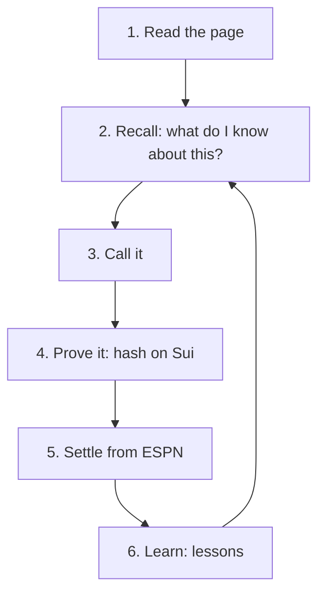

# Total Recall: how Soothia learns from your calls

Total Recall is the part of Soothia that remembers every call, scores it after the match, and changes what you see next. This page walks through the loop with @minos's real record. The figures come from [numbers.md](numbers.md), read on 10 Nov 2026.

## The loop

### 1. Read the page

The orb reads the match from an ESPN page: home, away, competition and kickoff. It reads only the page's own match header, never the scores bar of other games. On other pages, the Worker asks Claude to pick out claims that could be called. Each claim becomes a tile.

### 2. Recall

Before any tile is shown, the extension sends the claims to `POST /recall/insights`. The Worker:

1. Reads the user's whole record from Walrus Memory: picks, outcomes, lessons and preferences.
2. Runs a semantic search in the user's `pick` namespace for each claim's question, to find earlier calls on the same thing.
3. Builds each tile's notes (at most three, the most specific first), its relevance score, any call already made on the match, the calls of people the user follows, and the overall slider shrink.

The extension then sorts tiles by relevance, prints the notes, and hides the orb on quiet sites.

### 3. Call it

The user picks YES or NO and a confidence from 51% to 99%. The Worker checks the match on ESPN, then builds a `pick` record. Its hash is SHA-256 over a fixed list of fields, so anyone can recompute it later.

### 4. Prove it

Tatum's gRPC gateway gives the latest Sui checkpoint, which is stored as an anchor: the call was made after checkpoint N. Then the Worker commits the hash with `soothia_recall`, through Tatum. The commit's timestamp, set by Sui, is the proof that the call came before ESPN's kickoff. A spending guard caps commits at 5 a day per user and 50 overall. A call that isn't committed is still saved.

The pick is written to Walrus Memory as a sentence plus a tagged record:

> Call: YES at 70% on "Will Man City beat Fulham on November 21, 2026?" (sports). About Man City, Fulham. Read on espn.com.

### 5. Settle

A cron sweep runs every 15 minutes. For each open call it finds the match on ESPN's scoreboard, works out whether the call was right, scores it with the Brier score, and writes an `outcome`:

> Called it right: "Will Atlético Madrid beat Barcelona in Spanish LALIGA on Sun 8 Nov?" resolved NO. Atlético Madrid 1-2 Barcelona (ESPN, full time). My YES was 35%, Brier 0.122.

### 6. Learn

After each settle, the Worker derives lessons from every outcome so far:

| Key                    | Needs                                 | Says                                         |
| ---------------------- | ------------------------------------- | -------------------------------------------- |
| `calibration`          | 3 settled calls                       | Whether you claim more or less than you land |
| `favourites`           | 3 calls at 60%+                       | Whether your strong calls are earned         |
| `vs_market`            | 3 calls with a market price           | Whether you beat the market                  |
| `entity:<team>`        | 3 calls on one team                   | Whether you read that team well              |
| `category:<name>`      | 3 calls in one category               | Your blind spots                             |
| `stakes`, `stake_size` | 3 staked and 3 free calls             | Whether money makes you better               |
| `tail:<handle>`        | 3 tails of one person                 | How tailing them works out                   |
| `consensus`            | 3 calls against the people you follow | How going against them works out             |
| `premium`              | 3 settled premium unlocks             | Bought calls against your own                |

A lesson is written to Walrus only when its meaning changes, or one of its figures moves by 5 points or more. Otherwise the record would fill with near-copies.

## @minos's lessons, as they happened

All times are 8 Nov 2026, UTC. Calls were locked that morning, and results came in through the afternoon and evening.

| Time  | Settled       | Lesson written                                                                                        |
| ----- | ------------- | ----------------------------------------------------------------------------------------------------- |
| 16:00 | 6 (5 right)   | "You land 83% of calls while claiming 69%: you are 14 points underconfident. Back yourself more."     |
| 16:00 | 6             | "Your strong calls (60%+) come in 83% of the time, better than you claim. Your conviction is earned." |
| 16:15 |               | "Your confidence matches your hit rate (72% claimed, 71% landed). Keep calling it like this."         |
| 18:15 |               | "…(73% claimed, 67% landed)…"                                                                         |
| 19:00 |               | "…(73% claimed, 73% landed)…"                                                                         |
| 22:00 | 15 (12 right) | "Your confidence matches your hit rate (72% claimed, 80% landed). Keep calling it like this."         |

Ten lessons were written in all. Most of the calibration updates came before the 5-point rule was added on 9 Nov, which is why some differ by only a few points; today they would not be written. Two are current: calibration (15 calls) and favourites (6 calls). The calibration table on My record shows why:

| Said   | Calls | Right |
| ------ | ----- | ----- |
| 60–69% | 7     | 86%   |
| 70–79% | 4     | 75%   |
| 80%+   | 4     | 75%   |

## A tile before and after

These are the notes the Worker's `insightsFor` produces from @minos's real record, cut off at three moments, for three upcoming matches. A live tile can add one more line from Walrus's semantic search, such as "On 8 Nov you called NO 65% on …: right."

**Before any result (8 Nov, 13:00).** Nothing is known, so the tiles are bare:

- Liverpool v Manchester United: _no notes_
- Chelsea v Leeds United: _no notes_
- Barcelona v Villarreal: _no notes_

**After the first lesson (8 Nov, 16:05).** Six calls settled, and the record says @minos holds back:

- Liverpool v Manchester United: "Your record on Liverpool: 1 of 1 right." · "You run 14 points underconfident overall."
- Chelsea v Leeds United: "You run 14 points underconfident overall."
- Barcelona v Villarreal: "You run 14 points underconfident overall."

**Now (10 Nov).** Fifteen settled. The gap between claimed and landed is now 8 points, which no longer counts as a bias, so the underconfidence line is gone, and each team has its own line:

- Liverpool v Manchester United: "Your record on Liverpool: 1 of 1 right." · "Your record on Manchester United: 1 of 1 right."
- Chelsea v Leeds United: "Your record on Chelsea: 0 of 1 right."
- Barcelona v Villarreal: "Your record on Barcelona: 1 of 1 right." · "Your record on Villarreal: 1 of 1 right."

What else changes:

- **The slider.** An overconfident calibration lesson makes the Call it sheet suggest a value closer to 50%. @minos ran underconfident, so no suggestion appears.
- **The order.** A match already called, and teams called often, move a tile up the card.
- **My record.** The Lessons section shows the newest lesson per key, the most specific first.
- **Quiet sites.** @minos turned the orb off on espn.com and back on. Both are `pref` memories, and the newest wins.

## The record is portable

Each user's memories live in their own namespaces, `soothia-<userKey>-<kind>`, in Soothia's Walrus Memory account. The `userKey` comes from the install id, or from a "Link record" id that the user can paste into a second browser to bring the same record along. The Worker keeps only indexes and caches in KV: delete KV and the record, the lessons and the following list can all be rebuilt from Walrus.

## Where the code is

- Records and sentences: [worker/src/recall/records.ts](../worker/src/recall/records.ts)
- Walrus Memory client: [worker/src/recall/memory.ts](../worker/src/recall/memory.ts)
- Scoring, lessons and tile notes: [worker/src/recall/scoring.ts](../worker/src/recall/scoring.ts)
- Settling from ESPN: [worker/src/recall/resolve.ts](../worker/src/recall/resolve.ts), [worker/src/recall/espn.ts](../worker/src/recall/espn.ts)
- Commits and proofs through Tatum: [worker/src/recall/sui.ts](../worker/src/recall/sui.ts), [worker/src/recall/tatumGrpc.ts](../worker/src/recall/tatumGrpc.ts)
